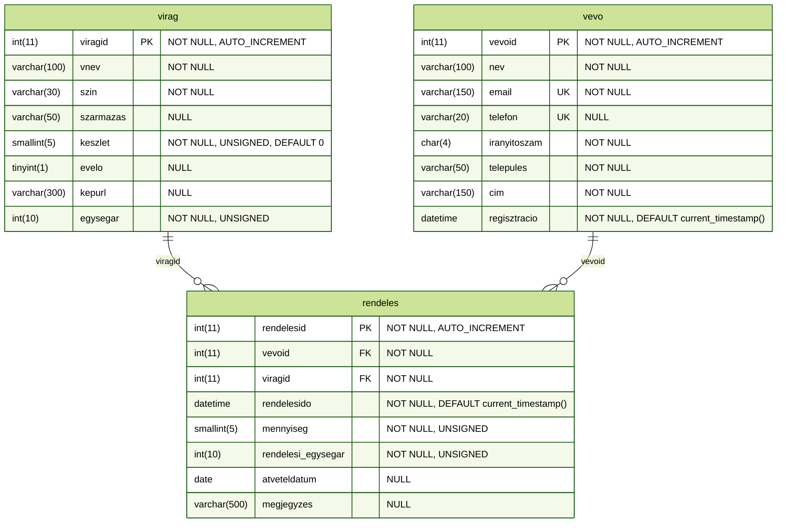

# viraguzlet adatbázis

## virag tábla

*virágüzlet kínálatban szereplő virágok*

| **mező** | **típus** | **megszorítás** | **leírás** | 
| :--- | :--- | :--- | :--- |
| **viragid** | egész | elsődleges kulcs, automatikusan növekvő | a virág egyedi azonosítója | 
| **vnev** | szöveg, változó hossz (100) | kötelező kitöltés | a virág neve | 
| **szin** | szöveg, változó hossz (30) | kötelező kitöltés | a virág színe | 
| **szarmazas** | szöveg, változó hossz (50) | nem kötelező kitöltés | a virág származási országa | 
| **keszlet** | előjel nélküli egész | kötelező kitöltés, alapértelmezetten 0 | aktuális készlet (szál) | 
| **evelo** | logikai | nem kötelező kitöltés | évelő növény-e (1,0) | 
| **kepurl** | szöveg, változó hossz (300) | nem kötelező kitöltés | a virágot ábrázoló kép elérési útvonala (jelenleg csak fájlnév) | 
| **egysegar** | előjel nélküli egész | kötelező kitöltés | egy szálra vonatkozó ár forintban | 

## vevo tábla

*regisztrált magán vásárlók*

| **mező** | **típus** | **megszorítás** | **leírás** | 
| :--- | :--- | :--- | :--- |
| **vevoid** | egész | elsődleges kulcs, automatikusan növekvő | a vevő egyedi azonosítója | 
| **nev** | szöveg, változó hossz (100) | kötelező kitöltés | a vevő teljes neve | 
| **email** | szöveg, változó hossz (150) | kötelező kitöltés, egyedi érték | a vevő email címe | 
| **telefon** | szöveg, változó hossz (20) | nem kötelező kitöltés, egyedi érték | a vevő telefonszáma | 
| **iranyitoszam** | szöveg, fix hossz (4) | kötelező kitöltés | a vevő lakhelyének irányítószáma | 
| **telepules** | szöveg, változó hossz (50) | kötelező kitöltés | a vevő lakhelyének városa | 
| **cim** | szöveg, változó hossz (150) | kötelező kitöltés | a vevő lakhelyének címe | 
| **regisztracio** | dátum-idő | kötelező kitöltés, alapértelmezetten current_timestamp() | a regisztráció pontos időpontja | 

## rendeles tábla

*rendelések (egy rendelés ezzel a struktúrával csak egy féle virágot tartalmazhat)*

| **mező** | **típus** | **megszorítás** | **leírás** | 
| :--- | :--- | :--- | :--- |
| **rendelesid** | egész | elsődleges kulcs, automatikusan növekvő | a rendelés egyedi azonosítója | 
| **vevoid** | egész | külső kulcs -> vevo.vevoid | megrendelő vevő azonosítója | 
| **viragid** | egész | külső kulcs -> virag.viragid | megrendelt virág azonosítója | 
| **rendelesido** | dátum-idő | kötelező kitöltés, alapértelmezetten current_timestamp() | megrendelés pontos ideje | 
| **mennyiseg** | előjel nélküli egész | kötelező kitöltés | rendelés mennyisége | 
| **rendelesi_egysegar** | előjel nélküli egész | kötelező kitöltés | a rendelés leadásakor aktuális egységár | 
| **atveteldatum** | dátum | nem kötelező kitöltés | a rendelés átvételének dátuma (null, ha még nem vették át) | 
| **megjegyzes** | szöveg, változó hossz (500) | nem kötelező kitöltés | a megrendeléshez kapcsolódó vevői igények | 

**táblák kapcsolata:**
